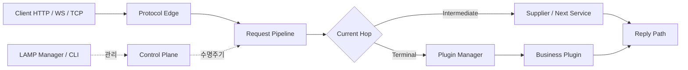

# LAMP — Lightweight Adaptive Microservices Platform

> **Public Documentation · 1.0-rc1 · Release Candidate · 2026-11-20**  
> 제품 소개 · 아키텍처 · 개발자 가이드 | 한국어 기준본

**LAMP는 C++23 기반 마이크로서비스 플랫폼으로, 통신·라우팅·메시지·플러그인 실행·서비스 운영이라는 반복적인 인프라 문제를 공통 계층으로 해결하도록 설계되었습니다.**

실시간 금융·이벤트 시스템처럼 지속적인 연결과 명확한 운영 통제가 필요한 환경을 주요 활용 대상으로 고려합니다. 제품 소개에 명시된 구조가 곧 특정 처리량, 무손실 동작이나 가용성 SLA를 보증하는 것은 아닙니다.

## 문서 시작하기

| 독자 | 추천 문서 |
|---|---|
| 기술 도입 검토자·고객사 | [제품 소개](docs/product/overview.md) · [핵심 가치와 적용 분야](docs/product/capabilities.md) |
| 아키텍트·기술 리더 | [전체 아키텍처](docs/architecture/overview.md) · [데이터 경로](docs/architecture/data-plane.md) |
| C++ 서비스 개발자 | [개발자 시작 안내](docs/developer/getting-started.md) · [서비스 개발](docs/developer/service-development.md) |
| 비즈니스 로직 개발자 | [플러그인 개발](docs/developer/plugin-development.md) |
| 클라이언트 개발자 | [클라이언트 연동](docs/developer/client-integration.md) |

## LAMP를 이해하는 핵심 모델

- **Control Plane:** 서비스의 구성과 생명주기 관리
- **Data Plane:** 메시지 수신·처리·서비스 연결·응답
- **Plugin:** 트랜잭션별 비즈니스 로직을 인프라 처리로부터 분리
- **도메인 분리:** 범용 플랫폼 `lamp` 위에 금융 공통 `lamp-fin`, 그 위에 고객별 구현 계층

## 릴리스 후보의 의미

`1.0-rc1`은 **공개 문서의 첫 릴리스 후보 버전**이며 LAMP 소프트웨어의 GA(상용 안정 버전), 공개 SDK 제공, 운영 성능 인증을 뜻하지 않습니다. 저장소가 비공개인 현재 상태에서 Quick Start는 공개적으로 재현되는 설치 명령 대신 준비 조건과 개발 흐름을 설명합니다.

읽기 전에 [지원 범위와 제약](docs/reference/verification-status.md), [버전 정책](VERSIONING.md), [공개 기준](PUBLICATION_POLICY.md)을 확인하세요.

© 2026 EM Plus. 문서의 재배포 및 라이선스 조건은 별도 허가 전까지 보류합니다. [LICENSE-NOTICE](LICENSE-NOTICE.md)
