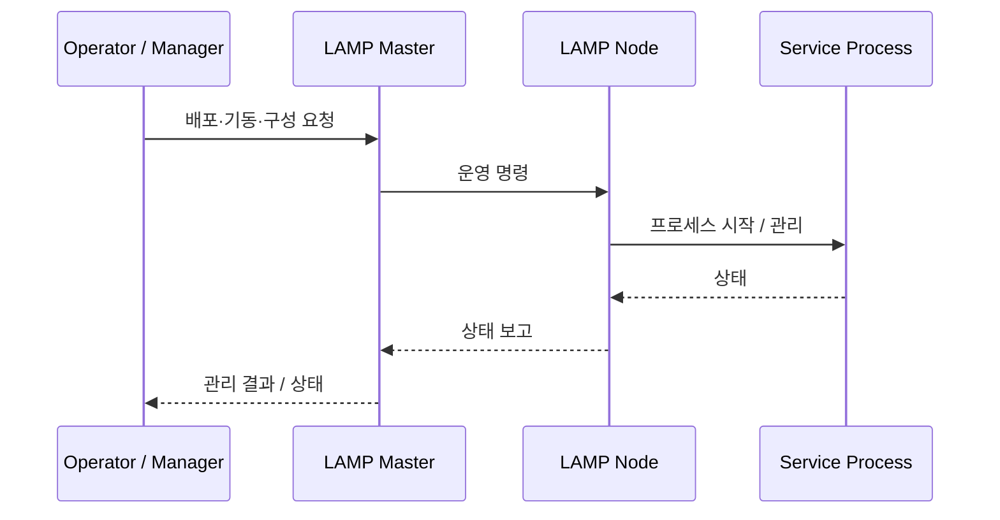

# Control Plane — 운영 제어 영역

LAMP 자체 운영 모드에서 **Master**는 서비스 구성·상태와 운영 명령을 다루고, **Node**는 해당 노드의 프로세스 생명주기를 관리합니다. Manager와 CLI는 관리 인터페이스를 사용합니다.

Kubernetes 모드에서는 Kubernetes Operator/Deployer와 Kubernetes API가 자원 관리의 중요한 부분을 담당합니다. 두 모드의 제어 흐름을 동일한 것으로 간주해서는 안 됩니다.

**장애 가용성:** Data Plane 서비스가 계속 처리할 수 있다는 설계와 Master 관리 계층이 장애 시 가용한지는 별개의 검증 항목입니다. 공개된 RC 문서는 Control Plane 전체의 Active-Active 또는 무중단 관리를 보장하지 않습니다.

관리 API 세부 경로, 토큰 및 운영 네트워크 설정은 공개 문서에 싣지 않습니다.
