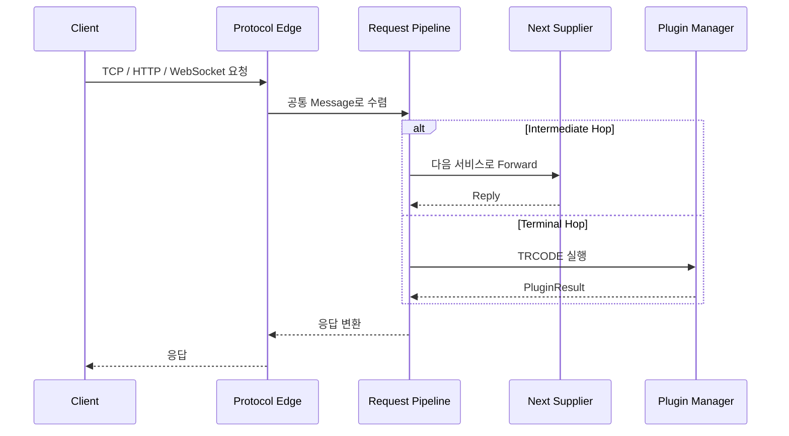

# Data Plane — 요청과 응답의 경로

## 요청 파이프라인

외부 통신 프로토콜과 내부 요청 모델은 동일하지 않습니다. 예를 들어 LAMP 내부 Message 프레이밍을 사용하는 HTTP/WS 인터페이스는 범용 JSON REST API와 다릅니다. 외부 OpenAPI 호환 계약을 제공하려면 Gateway 및 응답 형식 정책을 별도 명세해야 합니다.

## 성능과 스레드 모델

비동기 I/O, 내부 큐 및 업무 처리 루프는 고빈도 요청을 위한 분리 구조를 가집니다. 실제 코드는 `RequestPipeline`과 `PluginManager`를 포함합니다. 일부 플러그인 작업의 Worker Pool 전환에는 실험적 설정이 포함되어 있으므로, 모든 플러그인이 자동으로 별도 워커에서 실행된다는 설명은 적절하지 않습니다.

## 검증 범위

다중 접속 시나리오 및 TCP/HTTP/WS 벤치마크 스크립트는 존재하나, 이 문서 릴리스 후보를 만들면서 벤치마크를 재실행하지 않았습니다. 지연시간이나 초당 처리 건수는 게시하지 않습니다.
