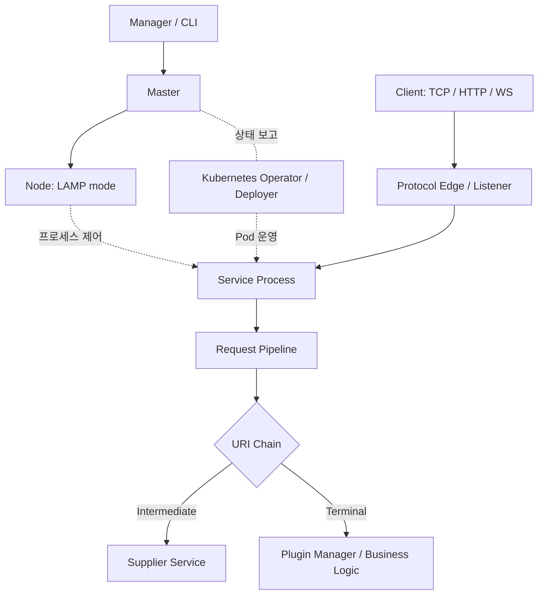

# LAMP 전체 아키텍처

LAMP는 구성 및 서비스 수명주기를 담당하는 **Control Plane**과 사용자 요청을 처리하는 **Data Plane**을 구분합니다.

> 개념도입니다. LAMP 모드와 Kubernetes 모드의 구성요소를 하나의 물리 배포도에 동시에 배치했다는 뜻이 아닙니다.

## 주요 영역

- **Master:** 관리 API·상태 집계·구성 및 명령 흐름의 진입점.
- **Node:** LAMP 자체 운영 모드에서 서비스 프로세스 제어와 상태 연계.
- **Server:** 네트워크 요청을 처리하고 Plugin 실행으로 연결하는 실행 프로세스.
- **Listener 또는 Direct Accept:** 배포와 설정에 따른 연결 수락 방식.
- **Studio / Manager:** 각각 개발 워크플로와 운영 제어를 지원하는 별도 도구.

## 원칙

1. 업무 처리의 경로와 운영 명령의 경로를 분리합니다.
2. 서비스 간 이동 경로를 URI의 서비스 체인으로 표현합니다.
3. 플러그인과 전송 프로토콜의 관심사를 분리합니다.
4. 도메인 및 고객별 코드는 플랫폼 코어의 역방향 의존을 만들지 않습니다.

자세한 설명: [Control Plane](control-plane.md), [Data Plane](data-plane.md), [서비스 라우팅](routing.md).
