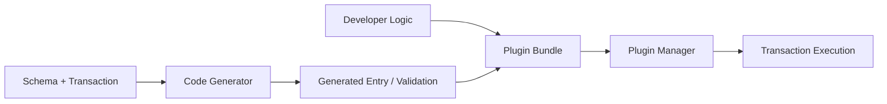

# 플러그인 실행 모델

LAMP Plugin은 도메인 트랜잭션을 실행하는 공유 라이브러리 모델입니다. 스키마 및 트랜잭션 정의에 기반해 필요한 연결 코드를 생성하고, 개발자가 업무 로직을 작성합니다.

## 실행 계약

- 진입점과 개발자 로직은 분리될 수 있습니다.
- 로더는 라이브러리 및 진입점 심볼을 찾아 연결합니다.
- 플러그인 ABI 세대가 호환되지 않으면 로드 실패로 처리하는 검사 계약이 존재합니다.
- 파일 감시 기반 재로드는 `--plugin-reload watch`가 필요한 **선택 모드**입니다. 기본 정책은 수동입니다.

## 공개 범위

내부 ABI의 상세 구조체, 런타임 보안 제약과 구현 전체를 여기에서 공개하지 않습니다. 정식 공개 SDK를 제공하는 경우 호환성 표와 헤더·샘플 코드를 별도로 배포해야 합니다.

[개발자 플러그인 가이드](../developer/plugin-development.md)
