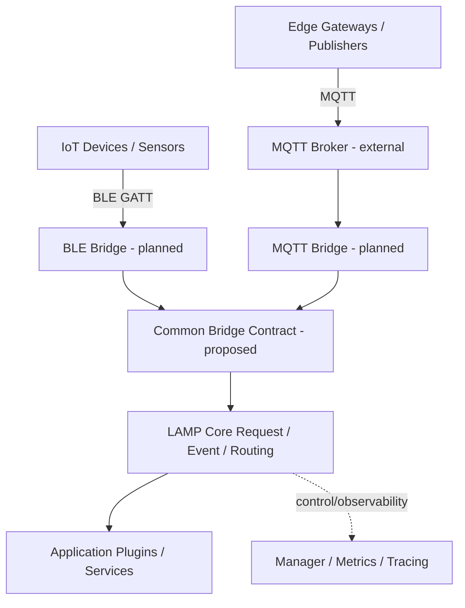

# Protocol Bridge 확장 아키텍처 (제안)

> **상태: Planned / Conceptual.** 아래 다이어그램은 현재 배포된 구현이 아니라 목표 구조입니다.

## 기본 설계 결정

1. **Core와 프로토콜 구현 분리:** MQTT/BLE 스택을 `lamp-core`에 하드코딩하지 않고 별도의 서비스/Adapter로 구축.
2. **공통 계약 최소화:** 정규화한 이벤트(envelope), 장치 식별자, 추적 ID, 타임스탬프, 페이로드 형식, 오류/확인 상태 등을 정의. 이것이 실제 Message/HDF 스키마와 어떻게 연결될지는 설계·검증 필요.
3. **프로토콜 고유 의미 보존:** MQTT Topic, QoS, retained, session, 재구독과 BLE GATT, MTU, 페어링, 알림(notification)은 각각 Bridge에 남김. Core에 무리하게 1:1로 매핑하지 않음.
4. **장치 신뢰 경계:** 장치/브로커 자격증명과 LAMP 서비스 권한은 별도로 관리. 인증·인가를 그대로 통과시키지 말고 Bridge에서 검증 및 권한 맵핑.
5. **장애 격리:** 브로커 또는 BLE 링크 실패가 Core 프로세스 안정성을 손상하지 않도록 분리하고, 백프레셔·유한 버퍼·재시도·데드레터 정책을 정의.

## 데이터 이동의 예

**Inbound:** 장치 또는 Broker → 해당 Bridge → 스키마 변환/검증 → LAMP 메시지/이벤트 라우팅 → 서비스 또는 Plugin.

**Outbound:** LAMP 애플리케이션 → Bridge 요청 계약 → 적절한 Topic publish 또는 BLE 쓰기 → 프로토콜별 성공/실패 결과.

**주의:** MQTT QoS 2가 전체 LAMP 처리의 end-to-end exactly-once를 뜻하지 않으며, BLE 연결과 MQTT 연결의 세션 수명도 동일하지 않습니다.

## 개방 과제

- MQTT 3.1.1/5.0 지원 범위, Broker 선택 및 운영 책임
- BLE Central/Peripheral 역할, Linux Edge 호스트 환경 및 권한
- LAMP HDF/JSON 변환, 이벤트 라우팅과 장치 식별 체계
- MQTT 메시지 ACK, 재처리·중복 제거, 보존 기간
- TLS/mTLS 등 전송 보안과 BLE 페어링/본딩 정책
- 장치 대수와 메시지율 기준 부하·장애·복원 시험

[IoT 로드맵](../product/iot-edge-roadmap.md) · [Bridge 개발 원칙](../developer/bridge-development.md)
