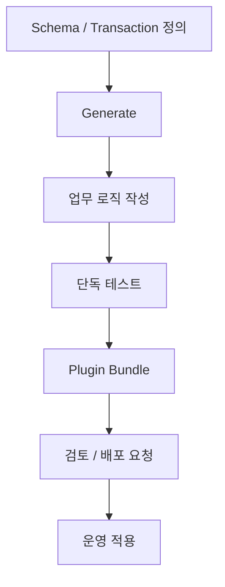

# 플러그인 개발 가이드

## 개발 흐름

1. 트랜잭션 코드와 요청·응답 스키마를 정의합니다.
2. 스키마 생성기가 진입점과 검증·변환 코드를 생성합니다.
3. 개발자는 생성된 템플릿의 **개발자 소유 로직 파일**에서 비즈니스 규칙을 구현합니다.
4. 요청 유효성, 오류 처리, 정합성 검사를 포함한 단독 테스트를 수행합니다.
5. Plugin Bundle을 빌드하고 승인 절차를 통해 운영 환경에 적용합니다.

## 생성 파일의 소유권

| 형태 | 책임 |
|---|---|
| `<TR>.cpp` | 개발자 로직; 일반적으로 개발자가 관리 |
| `<TR>.entry.gen.cpp` | 생성기 관리; 직접 수정 금지 |
| `<TR>.desc.gen.hpp` | 생성기 관리; 직접 수정 금지 |

## 호환성과 재로드

생성된 Plugin이 Core가 요구하는 ABI와 일치해야 합니다. Core와 Plugin의 인터페이스가 변경되면 재빌드가 필요할 수 있습니다. 자동 재로드는 파일 감시 옵션을 명시해야 하며, 변경 중 요청 보존 같은 주장은 각 환경의 테스트 결과로만 평가해야 합니다.

## 외부 예제 코드

상세 인터페이스와 컴파일 가능한 예제는 공개 SDK 및 배포 권한이 확정된 후 추가합니다. 이 RC에는 비공개 소스의 구현을 복제하지 않습니다.
